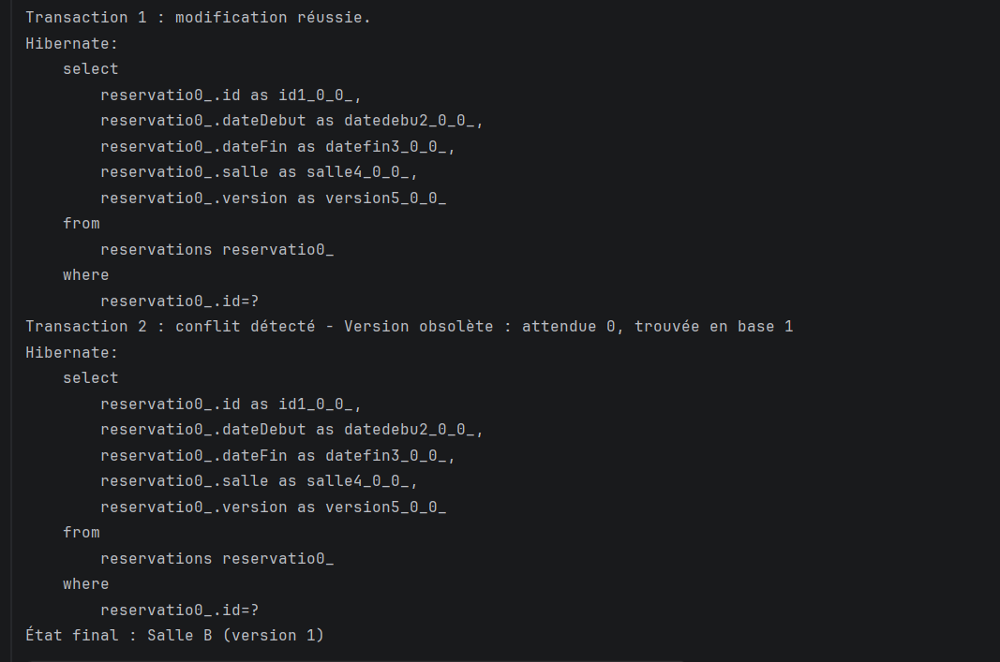
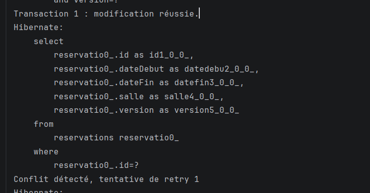
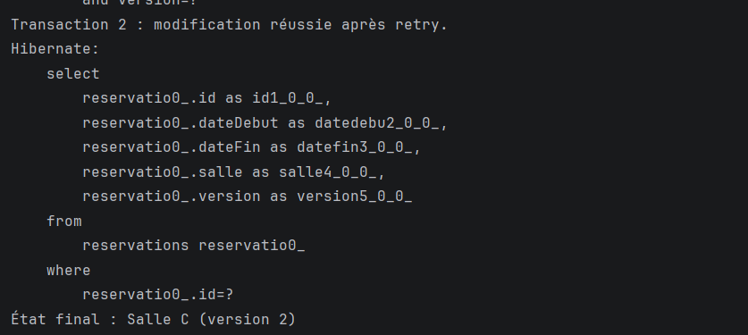

# Verrouillage optimiste avec JPA / Hibernate (@Version)

## Objectif du TP

L'objectif de ce TP est de mettre en œuvre le **verrouillage optimiste** avec JPA et Hibernate dans une application de réservation de salles.

Quand deux utilisateurs modifient la même réservation en même temps, la dernière modification risque d'écraser la première sans que personne ne s'en rende compte. Grâce au champ `@Version` de l'entité `Reservation`, Hibernate détecte ce conflit et lève une `OptimisticLockException`. Le TP montre d'abord la détection du conflit, puis sa résolution par une stratégie de **retry**.

## Description des captures d'écran

### 1. Conflit détecté sans retry

Exécution de la classe `ConcurrentReservationSimulator`. Deux transactions chargent la même réservation en version 0. La transaction 1 la modifie en « Salle B » : la modification réussit et la version passe à 1. La transaction 2 tente ensuite de la modifier en « Salle C » avec sa copie obsolète (version 0) : le conflit est détecté (`Version obsolète : attendue 0, trouvée en base 1`) et sa modification est refusée. L'état final est **Salle B (version 1)** : la première modification n'a pas été écrasée.

### 2. Conflit détecté avec retry

Exécution de la classe `ConcurrentReservationWithRetry`. La transaction 1 modifie la réservation en « Salle B » et la version passe à 1. La transaction 2 tente sa modification avec la version 0 : le conflit est détecté et le message `Conflit détecté, tentative de retry 1` s'affiche. Le gestionnaire de retry recharge alors la dernière version de la réservation depuis la base.

### 3. Conflit résolu après retry

Suite de l'exécution précédente. Après le rechargement, la modification « Salle C » est réappliquée sur la version à jour, et la nouvelle tentative réussit : `Transaction 2 : modification réussie après retry.` L'état final est **Salle C (version 2)** : les deux modifications ont été appliquées l'une après l'autre, chacune ayant incrémenté la version.